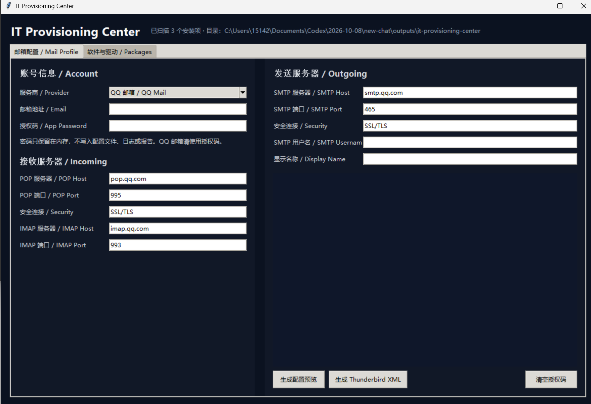
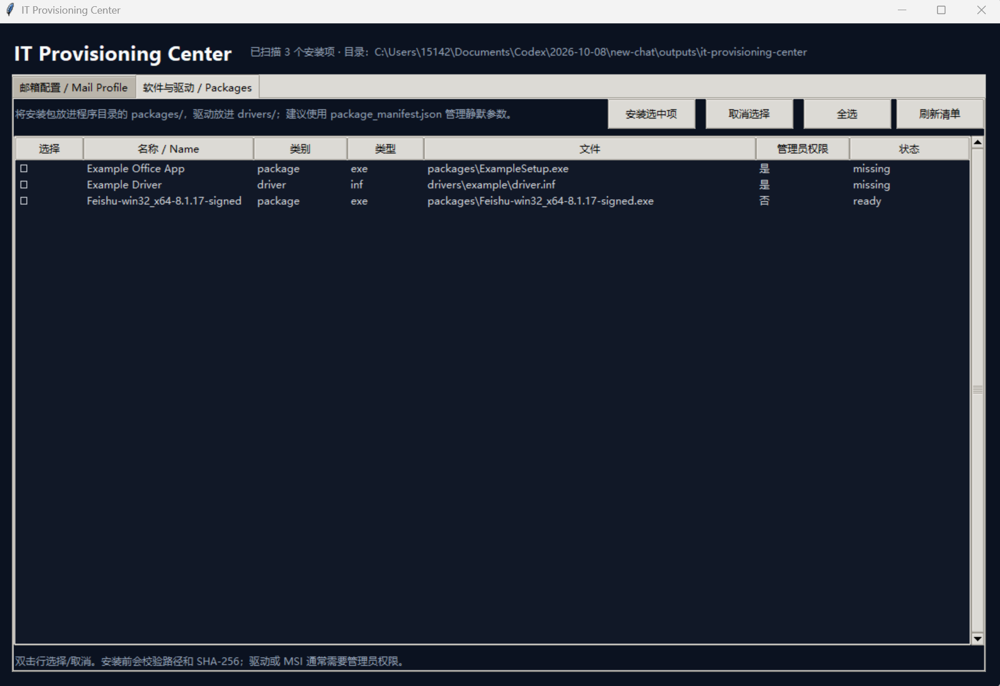

# 离线 IT 装机与办公环境自动化初始化工具

IT Provisioning Center

面向企业 IT 装机和账号配置场景的本地桌面原型。

## 新增：系统重装

“系统重装 / Windows Setup”页可选择**程序目录之外**的 Windows ISO，另选 INF 驱动目录。预检会核对 ISO 是否存在、文件大小、驱动 INF 数量和当前设备架构。

- **原位重装**：备份确认后挂载 ISO，交互式启动其中的 Windows Setup。Setup 会检查版本、语言和架构兼容性；只有安装界面明确显示可保留应用与文件时才继续。程序本身不保证保留数据。
- **全新安装**：检查 ISO 路径、扩展名和大小，生成 `logs/clean-install-plan-*.json`。仍需核对发布者提供的镜像 SHA-256，并另行把 ISO 制作成可启动 U 盘；从 U 盘启动后由操作员在 Windows Setup 中选择目标磁盘和分区。当前程序不会格式化磁盘，也不会自动制作启动盘。
- **重装后驱动**：再次打开程序，选择含 INF 的驱动目录，点击“重装后安装匹配驱动”。程序调用 `pnputil /add-driver *.inf /subdirs /install`，由 Windows 匹配当前硬件，结果写入 `logs/driver-install-*.json`。要求管理员权限。其他类型的驱动安装包可在“软件与驱动”页处理。

原位重装也需要管理员权限。ISO 和驱动来源须可信；全新安装前应把驱动放在不会被清空的位置，并验证重要数据备份。请使用 Windows 官方安装介质工具制作启动盘。

## 新增：实时诊断

“实时诊断 / Diagnostics”页每 2–10 秒采样 CPU、物理内存、系统盘空间，显示最近 60 个样本的趋势图，并采集高占用进程的 CPU、内存和磁盘读写速率。可手动或随采样探测回环地址、默认网关、DNS 解析、指定 TCP 主机端口、目标域名的 TCP 443 和实际 HTTPS 请求。每个 TCP 目标尝试 3 次，计算平均建连耗时、波动和失败率；这不是 ICMP 丢包率。界面绘制 CPU、内存、系统盘及 TCP 目标延迟趋势。最近 60 次网络采样也会写入导出的 JSON。

初步规则参考 CPU ≥85%、内存 ≥85%、系统盘 ≥90%，同时给出网关、DNS、TCP 层的检查建议。采集是只读的，支持导出含历史样本和判断依据的 JSON。网关禁止 ICMP、代理、VPN 或系统权限可能影响部分检测结果，应结合具体业务访问测试判断。

## 启动

请在装有完整 Tcl/Tk 组件的 Windows Python 环境运行；打包前先确认本机 `python app.py` 能打开窗口。

```powershell
python app.py
```

或双击 `start.bat`。

验证环境：

```powershell
python app.py --self-test
```

## 邮箱配置

邮箱页支持 QQ、163、Gmail 和自定义服务商预设。输入邮箱和授权码后，应用会自动填充 POP/SMTP/IMAP 参数，并可生成 Thunderbird XML 配置预览。

安全边界：

- 授权码只在内存中使用；
- 不写入 JSON、日志或安装命令；
- QQ/163 等服务商通常需要客户端授权码；
- 当前版本生成客户端配置文件，不强行修改 Outlook/Windows Mail/Thunderbird 的真实用户 Profile；
- 真实客户端自动配置需要按具体客户端和企业策略接入。

## 软件和驱动

将安装包放在：

```text
it-provisioning-center/
├── app.py
├── packages/
├── drivers/
└── package_manifest.json
```

复制 `package_manifest.example.json` 为 `package_manifest.json`，修改文件名和静默参数。也可以不配置清单，程序会扫描 `packages/` 和 `drivers/` 中的 `.exe/.msi/.msix/.inf/.ps1/.bat/.cmd` 文件。

如果存在 `package_manifest.json`，程序现在会将“清单项目”和“目录中自动发现的项目”合并，不会因为示例清单而停止扫描。也支持直接把 `.exe/.msi/.msix/.msixbundle/.appx/.inf/.cab` 放在程序 EXE 同级目录。

双击软件行可以选择，再点击“安装选中项”。安装前会：

1. 检查文件是否位于程序目录内；
2. 校验可选的 SHA-256；
3. 显示管理员权限要求；
4. 按清单执行并等待退出码；
5. 将结果写入 `logs/`。

请只放入来源可信、已验证的安装包。驱动和脚本执行前应先在测试电脑验证。

## 界面截图

### 邮箱配置 / Mail Profile



### 软件与驱动 / Packages



## 打包为 U 盘便携版

在 Windows 上使用与目标电脑架构一致、包含完整 Tcl/Tk 的 Python，安装 PyInstaller：

```powershell
py -m pip install pyinstaller
```

然后在当前目录运行：

```powershell
.\build_portable.ps1
```

输出目录：

```text
dist\ITProvisioningCenter\
├── ITProvisioningCenter.exe
├── packages\
├── drivers\
├── logs\
└── package_manifest.json
```

把整个 `dist\ITProvisioningCenter` 文件夹复制到 U 盘。建议使用 `--onedir`，不要使用 `--onefile`，因为安装包、驱动和日志需要与程序保持在同一目录结构中。
